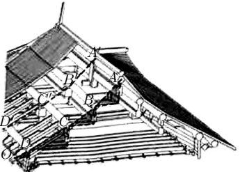
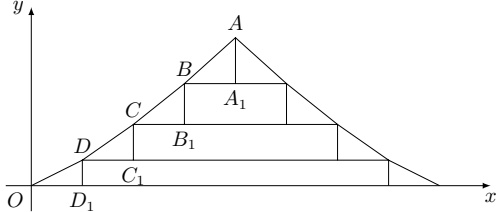
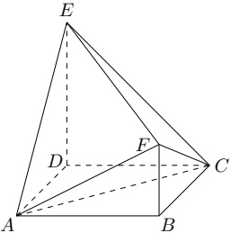

# 2022 普通高等学校招生考试 (新高考 II)

## 一、 单选题

1. 已知集合  $ A = \{-1, 1, 2, 4\} $,  $ B = \{x \mid |x - 1| \leqslant 1\} $, 则  $ A \cap B = $ ( )

(A)  $ \{-1, 2\} $ (B)  $ \{1, 2\} $ (C)  $ \{1, 4\} $ (D)  $ \{-1, 4\} $

2.  $ (2+2i)(1-2i)= $ ()

(A)  $ -2+4i $ (B)  $ -2-4i $ (C)  $ 6+2i $ (D)  $ 6-2i $

3. 图1 是中国的古建筑中的举架结构， $ AA^{\prime} $， $ BB^{\prime} $， $ CC^{\prime} $， $ DD^{\prime} $ 是桁，相邻桁的水平距离称为步，垂直距离称为举。图2 是某古建筑屋顶截面示意图，其中  $ DD_{1} $， $ CC_{1} $， $ BB_{1} $， $ AA_{1} $ 是举， $ OD_{1} $， $ DC_{1} $， $ CB_{1} $， $ BA_{1} $ 是相等的步，相邻桁的举步之比分别为  $ \frac{DD_{1}}{OD_{1}} = 0.5 $， $ \frac{CC_{1}}{DC_{1}} = k_{1} $， $ \frac{BB_{1}}{CB_{1}} = k_{2} $， $ \frac{AA_{1}}{BA_{1}} = k_{3} $。已知  $ k_{1} $， $ k_{2} $， $ k_{3} $ 成公差为 0.1 的等差数列，且直线 OA 的斜率为 0.725，则  $ k_{3} = (\quad) $

图1

图2

(A) 0.75 (B) 0.8 (C) 0.85 (D) 0.9

4. 已知向量  $ \boldsymbol{a} = (3, 4) $,  $ \boldsymbol{b} = (1, 0) $,  $ \boldsymbol{c} = \boldsymbol{a} + \boldsymbol{t}\boldsymbol{b} $，若  $ \langle \boldsymbol{a}, \boldsymbol{c} \rangle = \langle \boldsymbol{b}, \boldsymbol{c} \rangle $，则  $ t = (\quad) $

(A) -6

(B) -5

(C) 5

(D) 6

5. 甲、乙、丙、丁、戊 5 名同学站成一排参加文艺汇演，若甲不站在两端，丙和丁相邻，则不同排列方式共有 ___

(A) 12 种 (B) 24 种 (C) 36 种 (D) 48 种

6. 若  $ \sin(\alpha + \beta) + \cos(\alpha + \beta) = 2\sqrt{2}\cos\left(\alpha + \frac{\pi}{4}\right)\sin\beta $，则 ( )

(A)  $ \tan(\alpha - \beta) = 1 $

(B)  $ \tan(\alpha + \beta) = 1 $

(C)  $ \tan(\alpha - \beta) = -1 $

(D)  $ \tan(\alpha + \beta) = -1 $

7. 已知正三棱台的高为 1，上、下底面的边长分别为  $ 3\sqrt{3} $ 和  $ 4\sqrt{3} $，其顶点都在同一球面上，则该球的表面积为 ( )

(A)  $ 100\pi $ (B)  $ 128\pi $ (C)  $ 144\pi $ (D)  $ 192\pi $

8. 已知函数  $ f(x) $ 的定义域为  $ \mathbb{R} $，且  $ f(x+y) + f(x-y) = f(x)f(y) $， $ f(1) = 1 $，则  $ \sum_{k=1}^{22} f(k) = $ （）

(A) -3          (B) -2          (C) 0          (D) 1

## 二、 多选题

9. 已知函数  $ f(x) = \sin(2x + \varphi) $ ( $ 0 < \varphi < \pi $) 的图象关于点  $ \left(\frac{2\pi}{3}, 0\right) $ 中心对称，则 ( )

(A)  $ f(x) $ 在区间  $ \left(0, \frac{5\pi}{12}\right) $ 单调递减

(B)  $ f(x) $ 在区间  $ \left(-\frac{\pi}{12}, \frac{11\pi}{12}\right) $ 有两个极值点

(C) 直线  $ x = \frac{7\pi}{6} $ 是曲线  $ y = f(x) $ 的对称轴

(D) 直线  $ y = \frac{\sqrt{3}}{2} - x $ 是曲线  $ y = f(x) $ 的切线

10. 已知 O 为坐标原点，过抛物线 C:  $ y^2 = 2px $ (p > 0) 焦点 F 的直线与 C 交于 A, B 两点，其中 A 在第一象限，点 M(p, 0). 若  $ |AF| = |AM| $，则 ( )

(A) 直线 AB 的斜率为  $ 2\sqrt{6} $

(B)  $ |OB| = |OF| $

(C)  $ |AB| > 4|OF| $

(D)  $ \angle OAM + \angle OBM < 180^\circ $

11. 如图，四边形 ABCD 为正方形， $ ED \perp $ 平面 ABCD， $ FB \parallel ED $，AB = ED = 2FB。记三棱锥 E - ACD，F - ABC，F - ACE 的体积分别为  $ V_{1} $， $ V_{2} $， $ V_{3} $，则（）

(A)  $ V_{3}=2V_{2} $ (B)  $ V_{3}=V_{1} $ (C)  $ V_{3}=V_{1}+V_{2} $ (D) 2 $ V_{3}=3V_{1} $

12. 若 x, y 满足  $ x^{2} + y^{2} - xy = 1 $，则 ( )

(A)  $ x + y \leqslant 1 $ (B)  $ x + y \geqslant -2 $ (C)  $ x^{2} + y^{2} \leqslant 2 $ (D)  $ x^{2} + y^{2} \geqslant 1 $

13. 已知随机变量  $ X $ 服从正态分布  $ N(2, \sigma^2) $，且  $ P(2 < X \leq 2.5) = 0.36 $，则  $ P(X > 2.5) = $ ___.

14. 曲线  $ y = \ln |x| $ 经过坐标原点的两条切线的方程分别为___，___.

## 三、 填空题

15. 设点  $ A(-2,3) $,  $ B(0,a) $, 若直线 AB 关于 y = a 对称的直线与圆  $ (x+3)^2 + (y+2)^2 = 1 $ 有公共点，则 a 的取值范围是 ___。

16. 已知直线 l 与椭圆  $ \frac{x^2}{6} + \frac{y^2}{3} = 1 $ 在第一象限交于 A, B 两点，l 与 x 轴、y 轴分别交于 M, N 两点，且  $ |MA| = |NB| $,  $ |MN| = 2\sqrt{3} $，则 l 的方程为 ___。

17. 已知 $\{a_n\}$ 是等差数列，$\{b_n\}$ 是公比为 2 的等比数列，且 $a_2 - b_2 = a_3 - b_3 = b_4 - a_4$。

(1) 证明：$a_1 = b_1$；

(2) 求集合 $\{k \mid b_k = a_m + a_1, 1 \leq m \leq 500\}$ 中元素的个数。

## 四、 解答题

18. 记  $ \triangle ABC $ 的内角 A, B, C 的对边分别为 a, b, c，分别以 a, b, c 为边长的三个正三角形的面积依次为  $ S_{1} $,  $ S_{2} $,  $ S_{3} $. 已知  $ S_{1} - S_{2} + S_{3} = \frac{\sqrt{3}}{2} $,  $ \sin B = \frac{1}{3} $.

(1) 求  $ \triangle ABC $ 的面积;

(2) 若  $ \sin A \sin C = \frac{\sqrt{2}}{3} $, 求 b.