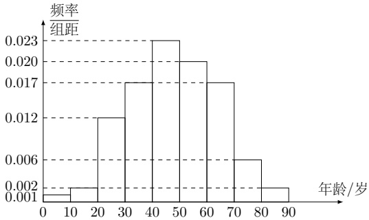
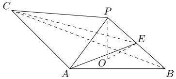

19. 在某地区进行流行病学调查，随机调查了100位某种疾病患者的年龄，得到如下的样本数据的频率分布直方图.

(1) 估计该地区这种疾病患者的平均年龄; (同一组中的数据用该区间的中点值为代表)

(2) 估计该地区一位这种疾病患者的年龄位于区间  $ [20,70) $ 的概率；

(3) 已知该地区这种疾病患者的患病率为 0.1%，该地区年龄位于区间  $ [40,50) $ 的人口占该地区总人口的 16%。从该地区中任选一人，若此人的年龄位于区间  $ [40,50) $，求此人患这种疾病的概率。(以样本数据中患者的年龄位于各区间的频率作为患者的年龄位于该区间的概率，精确到 0.0001)

20. 如图，PO 是三棱锥 P-ABC 的高，PA = PB， $ AB \perp AC $，E 为 PB 的中点.

(1) 证明： $ OE \parallel $ 平面 PAC;

(2) 若  $ \angle ABO = \angle CBO = 30^{\circ} $, PO = 3, PA = 5, 求二面角 C - AE - B 正弦值.

21. 已知双曲线 C:  $ \frac{x^{2}}{a^{2}} - \frac{y^{2}}{b^{2}} = 1 $ (a > 0, b > 0) 的右焦点为 F(2,0)，渐近线方程为  $ y = \pm \sqrt{3}x $.

(2) 过 F 的直线与 C 的两条渐近线分别交于 A, B 两点，点  $ P(x_{1}, y_{1}) $,  $ Q(x_{2}, y_{2}) $ 在 C 上，且  $ x_{1} > x_{2} > 0 $,  $ y_{1} > 0 $. 过 P 且斜率为  $ -\sqrt{3} $ 的直线与过 Q 且斜率为  $ \sqrt{3} $ 的直线交于点 M. 从下面①②③中选取两个作为条件，证明另外一个成立.

① M 在 AB 上；②  $ PQ \parallel AB $; ③  $ \left|MA\right| = \left|MB\right| $.

22. 已知函数  $ f(x) = x \mathrm{e}^{ax} - \mathrm{e}^x $.

(1) 当  $ a = 1 $ 时，讨论  $ f(x) $ 的单调性；

(2) 当  $ x > 0 $ 时， $ f(x) < -1 $，求  $ a $ 的取值范围；

(3) 设  $ n \in \mathbb{N}^* $，证明： $ \frac{1}{\sqrt{1^2 + 1}} + \frac{1}{\sqrt{2^2 + 2}} + \cdots + \frac{1}{\sqrt{n^2 + n}} > \ln(n + 1) $.